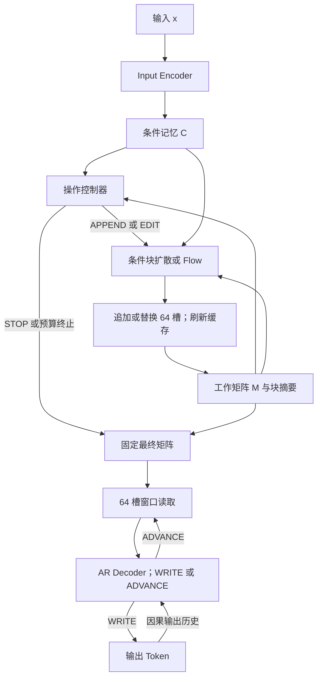

# 架构与状态语义

> 状态：设计规范与首版实现建议，尚未由代码或实验验证。来源为[完整技术设计](technical-design.md)第 2–4、8、12 节。

## 数据流

`Latent Encoder E_lat` 在训练时把目标 `y` 编码为监督矩阵，不属于上述正常推理数据流。第一版 Decoder 建议只接收潜在窗口、输出历史和输出控制变量，不直接读取输入条件 `C`；直接读取 `C` 作为单独对照研究。

## 张量与组件契约

| 对象 | 形状或取值 | 约束 |
| --- | --- | --- |
| 输入条件 `C = E_in(x)` | `[B, L, d_c]` | 带输入有效长度或 mask；推理期可保留 |
| 训练目标 `Z* = E_lat(y)` | `[B, 64K, d_z]` | 带样本级有效块数；不可作为推理输入 |
| 工作矩阵 `M_k` | `[B, 64K_k, d_z]` | batch 内 padding 不计为实际槽位 |
| 更新窗口 `W` | `[B, 64, d_z]` | 一次生成或修订的基本单位 |
| 操作 `a` | `APPEND / EDIT / STOP` | 根据状态与剩余预算屏蔽非法操作 |
| EDIT 起点 `s` | `0 <= s <= n-64` | 首版额外要求 `s % 64 == 0` |
| 采样步数 `T` | 正整数 | 初始比较 4、8、16、32 步，不预设最优值 |
| Decoder 步长 `r` | 整数 1–64 | 只控制窗口推进，不直接决定 Token 数 |

两个 Encoder 默认不共享权重；共享 tokenizer 不意味着共享 embedding。块更新网络可先将 `d_z` 投影到更宽的 `d_h`，再投影回 `d_z`，其隐层宽度不必与矩阵宽度相同。

## 工作矩阵的操作

### APPEND

更新器基于 `C`、当前状态摘要、位置与操作类型采样一个新块，并在末尾追加。`n` 增加 64；既有槽位不应被此操作改写。创建新块摘要，并更新全局或检索索引。

### EDIT

选择 `[s, s+64)`，将旧窗口作为修复条件之一，以正确目标或任务反馈学习修订。更新后 `n` 不变，区间外的原始槽值保持不变。首版只允许块对齐起点。

扩展到任意起点后，一次编辑可能跨两个基础块。所有与编辑区间相交的块摘要、检索条目及依赖缓存均需失效或重算。摘要刷新只修复缓存一致性，不能自动保证后续块的语义仍然正确；依赖重查或局部重算需要独立机制。

### STOP 与预算终止

`STOP` 不改写矩阵，结束内部推理。达到 `max_ops`、`max_blocks` 或总计算预算时，应显式记录预算终止原因，不能把强制终止记作策略主动 STOP。

空矩阵的初始化方式尚待决策：可先生成一个块，或由条件初始化器提供至少一个块。首版应在输出前保证至少有一个有效块。空状态不能 EDIT；如允许空状态 STOP，必须定义其解码或拒绝策略。本文不把某一种初始化方案记为已经确定。

## 块生成与修复

DDPM 路径通过带噪目标窗口预测噪声；Flow Matching 路径沿噪声与目标之间的连续路径学习速度场。两者均接收时间、条件、状态上下文、位置与操作信息；训练公式见[完整设计](technical-design.md)。

APPEND 与 EDIT 需要不同的监督语义：前者生成新内容，后者修复已知错误。仅给旧块加高斯噪声并恢复原块，不能证明模型学会了有效纠错。应使用结构化破坏、错误中间步骤及模型自身生成的错误状态，并检查修复后的答案。

## 64 槽局部读取

固定最终矩阵后，Decoder 的 Cross-Attention 每次只接收当前 64 槽窗口；Self-Attention 仍因果读取所有已输出 Token。原文的 `detach()` 表示切断梯度，它本身不保证张量不可被原地修改；实现还需通过不可变快照或生命周期约束固定读取内容。

首版对窗口起点采用以下推进规则：

$$
p_0=0,\qquad p_{j+1}=\min(p_j+r,n-64).
$$

当 `n >= 64` 时，完整扫描的窗口数为：

$$
N_{windows}=\left\lceil\frac{n-64}{r}\right\rceil+1.
$$

当跨度不能整除步长时，最后一次移动小于 `r`。例如 `n=256, r=50` 的起点为 `0, 50, 100, 150, 192`。若已到末窗口，继续 ADVANCE 不应形成无限循环；应屏蔽该动作并允许 WRITE/EOS，或触发明确的读取预算终止。`n<64` 的通用接口需 padding 与 mask，但正常动态状态建议采用完整块。

| `n=256` 时步长 | 完整扫描窗口数 | 按该步长推进时的重叠槽数 |
| ---: | ---: | ---: |
| 1 | 193 | 63 |
| 8 | 25 | 56 |
| 16 | 13 | 48 |
| 32 | 7 | 32 |
| 64 | 4 | 0 |

正式方案建议预测 WRITE/ADVANCE；每 `q` 个 Token 固定推进作为基线。详略实验需固定相同的 `M_final`，分别控制 `r`、详细度标签与输出长度上限。完整扫描的窗口数是覆盖性质；如 Decoder 提前 EOS，还须单独记录实际访问覆盖。

## 缓存约束

- Decoder 输出 Token 的自注意力 KV cache 可随输出增长；矩阵窗口变化时刷新对应 Cross-Attention K/V。
- 缓存标识至少区分样本、矩阵版本、窗口起点和可见性 mask，不能只按窗口编号复用。
- EDIT 后刷新所有受影响摘要；更改窗口或矩阵版本后不能读取旧投影。
- batch 内各样本的块数、窗口、STOP 和有效 mask 独立更新，padding 不能泄漏成可见内容。

接口与验证检查项见[工程实施指南](engineering.md)；架构选择的状态见[设计决策](decisions.md)。
